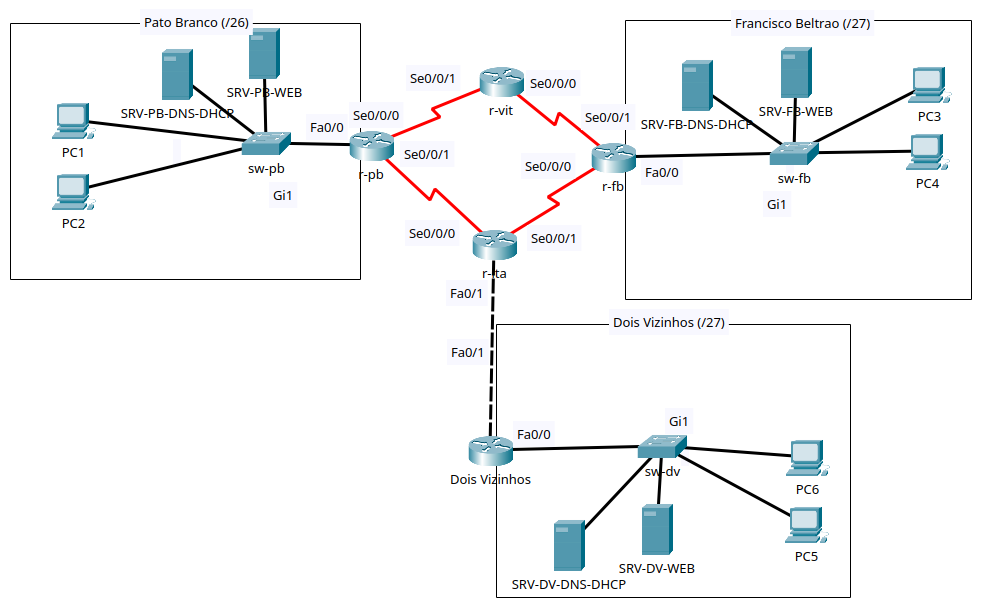
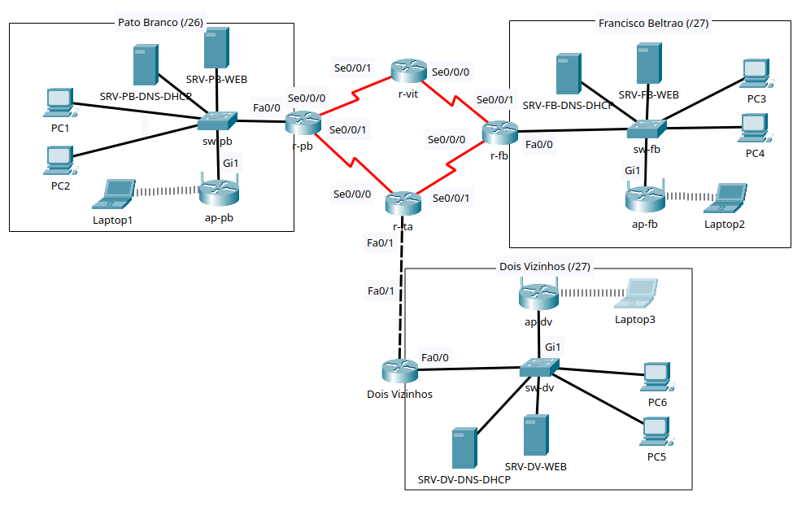

# Trabalho: Integração de habilidades - 2026/2

## Disciplina: Redes de Computadores

### Cursos: Engenharia de Computação / Engenharia Elétrica / Tecnologia em Análise e Desenvolvimento de Sistemas

## Objetivo

Este trabalho prático tem como objetivo proporcionar aos alunos a aplicação dos conceitos de redes de computadores por meio do desenvolvimento de uma topologia de rede que simula um cenário real de interligação de campi, serviços de infraestrutura e integração entre redes cabeadas e Wi-Fi.

Ao concluir esta atividade, você será capaz de demonstrar que obteve as seguintes habilidades:

  * **Projetar a Rede Lógica:** Aplicar **VLSM em IPv4** e sub-redes em **IPv6** para criar um esquema de endereçamento eficiente para a topologia.
  * **Configurar Serviços de Rede:** Implementar e integrar serviços essenciais de infraestrutura (**DHCP, DNS e HTTP**) em uma arquitetura distribuída.
  * **Definir e Implementar Rotas:** Criar e configurar **rotas estáticas** para viabilizar a comunicação entre redes remotas, utilizando fluxo assimétrico em IPv4 e IPv6.
  * **Configurar Topologia:** Configurar roteadores e switches utilizando **interface de linha de comando (CLI)** e configurar servidores, PCs, notebooks e pontos de acesso pelas interfaces disponíveis no Packet Tracer.
  * **Integrar o Acesso Wi-Fi:** Configurar um **ponto de acesso (AP)** em cada LAN, com autenticação **WPA2-PSK/AES**, permitindo que clientes sem fio utilizem a mesma sub-rede e os mesmos serviços dos computadores cabeados.
  * **Verificar a Conectividade:** Garantir a comunicação plena entre todos os elementos da rede, validando a conectividade em IPv4, IPv6 e a **resolução de nomes de domínio (DNS)**.
  * **Definir e Implementar Segurança:** Configurar e validar **medidas básicas de segurança** e acesso remoto seguro (SSH) nos equipamentos intermediários.
  * **Documentar a Rede:** Realizar a documentação completa do projeto de rede.

## Descrição da Atividade e Topologia

Neste trabalho, você deverá projetar e implementar uma rede que interliga centros de pesquisa associados aos campi da UTFPR em **Pato Branco, Francisco Beltrão e Dois Vizinhos**. O trabalho será desenvolvido em etapas: planejamento, montagem e funcionamento das LANs, comunicação entre redes, segurança básica e expansão com acesso Wi-Fi.

A **Figura 1** apresenta a topologia cabeada do trabalho. Na **Entrega 2**, cada LAN deverá funcionar internamente, com os serviços locais configurados. Na **Entrega 3**, a rede cabeada deverá estar completa, com comunicação entre campi em IPv4 e IPv6 e segurança básica.

<a id="figura1"></a>



*Figura 1 — Topologia física cabeada, utilizada nas Tarefas 3 a 8 e nas Entregas 2 e 3.*

Cada LAN deverá conter **2 PCs cabeados e 2 servidores**, conectados ao switch do campus. Os roteadores deverão interligar as LANs, com roteamento funcional em **IPv4 e IPv6**.

Cada campus deverá ter sua própria infraestrutura de serviços, conforme o Quadro 1.

<a id="quadro-1-infraestrutura-de-serviços-por-campus"></a>

#### Quadro 1: Infraestrutura de Serviços por Campus

| Campus | Servidor DNS/DHCP | Servidor Web | Subdomínio |
| :--- | :--- | :--- | :--- |
| **Pato Branco** | `SRV-PB-DNS-DHCP` | `SRV-PB-WEB` | `www.pb.utfpr.tec.br` |
| **Francisco Beltrão** | `SRV-FB-DNS-DHCP` | `SRV-FB-WEB` | `www.fb.utfpr.tec.br` |
| **Dois Vizinhos** | `SRV-DV-DNS-DHCP` | `SRV-DV-WEB` | `www.dv.utfpr.tec.br` |

O projeto prevê a expansão de **cada LAN com 1 AP e 1 notebook Wi-Fi**, apresentada na [Figura 2](#figura2), na [Tarefa 9](#tarefa-9). O AP será implementado por um **roteador sem fio** conectado ao switch da respectiva LAN. Essa expansão será implementada na **Entrega 4**, após a aula sobre Wi-Fi.

> **Planejamento desde a primeira entrega:** os endereços dos futuros APs deverão ser calculados e registrados na **Tarefa 2 / Entrega 1**: IPv4, máscara e gateway, além de IPv6/prefixo e gateway. O quinto endereço IPv4 válido de cada LAN ficará reservado para o AP. A documentação de SSID, senha e demais parâmetros Wi-Fi será preenchida na **Tarefa 9 / Entrega 4**.

Ao final, o trabalho deverá conter a documentação do projeto e a topologia completa e funcional no Packet Tracer, com clientes cabeados e sem fio utilizando os serviços dos campi.

-----

## 📑 Tarefa 1: Projetar e Documentar as Sub-redes

Utilize o bloco de endereços **IPv4 200.136.N.0/24** e **IPv6 2001:DB8:CAFE:NN00::/56** (em que **N** e **NN** são os dois últimos dígitos do seu RA) para criar as sub-redes, de acordo com as seguintes especificações:

1.  **Prefixos IPv4:** /26 para Pato Branco, /27 para Francisco Beltrão/Dois Vizinhos e futuros centros, /30 para enlaces WAN.
    - Deve-se prever a expansão da rede com três novos centros de pesquisa, localizados na região oeste do Paraná, nas cidades de Toledo, Medianeira e Santa Helena, as sub-redes para esses três centros deve utilizar o prefixo **/27**.
2.  **Prefixos IPv6:** /64 para todas as LANs, /112 para enlaces WAN.
3.  **Alocação das sub-redes para LANs:**
    - Utilize a **primeira sub-rede** para a LAN de **Pato Branco**.
    - Utilize a **segunda sub-rede** para a LAN de **Francisco Beltrão**.
    - Utilize a **terceira sub-rede** para a LAN de **Dois Vizinhos**.
    - Reserve a **quarta, quinta e sexta sub-redes** para os futuros centros de pesquisa que estão em implantação na região oeste do estado
4.  **Alocação das sub-redes para WANs:**
    - No IPv4, utilize a **última sub-rede /27 disponível** para subdividir em blocos **/30**, destinados aos enlaces entre roteadores (**pb-vit, vit-fb, fb-ita, ita-pb, ita-dv**, e também os enlaces para os novos centros de pesquisa).
    - No IPv6, utilize a **última sub-rede /64 disponível** para subdividir em blocos **/112**, destinados aos mesmos enlaces entre roteadores.


> **Integração do Wi-Fi:** o AP e seu notebook pertencem à LAN do respectivo campus. Portanto, a inclusão do Wi-Fi utiliza as sub-redes IPv4 e IPv6 já previstas para PB, FB e DV.

> 💡 **Dica:** Você pode incluir as informações de sub-redes diretamente na topologia (no Packet Tracer) para facilitar a visualização e organização do projeto.

  * **Documentar** todas as sub-redes (IPv4 e IPv6) conforme o [modelo](trabalho-documentacao-modelo.md).


-----

<a id="tarefa-2"></a>

## 🖥️ Tarefa 2: Plano de Endereçamento Lógico (Documentação)

Esta tarefa exige a documentação completa do esquema de endereçamento lógico, definindo os endereços IPv4 e IPv6 (Global Unicast Address-GUA e Link-Local) para a infraestrutura e o uso de endereçamento automático para os clientes cabeados (PCs) e sem fio (notebooks). O endereço de gerenciamento do AP também deverá ser documentado.

### 2.1. Endereçamento Estático (LANs e WANs)

Os endereços IPv4 e os endereços IPv6 GUA devem ser atribuídos **manualmente** aos dispositivos de infraestrutura (roteadores, switches e servidores), seguindo a ordem de host válido da respectiva sub-rede. Para os futuros APs, **defina e documente desde a Entrega 1** o IPv4 de gerenciamento, a máscara e o gateway. Defina também o IPv6/prefixo e o gateway; utilize o identificador de interface `::5` no /64 do campus e o gateway `FE80::1`. A configuração desses endereços nos APs será realizada na **Entrega 4**.

#### A. Endereçamento nas LANs (Pato Branco, Francisco Beltrão e Dois Vizinhos)

Em cada LAN, os **cinco primeiros** endereços de host válidos são reservados para a infraestrutura de serviços conforme descrito no [**Quadro 2**](#quadro-2-regras-de-endereçamento-estático-fixo-nas-lans):

<a id="quadro-2-regras-de-endereçamento-estático-fixo-nas-lans"></a>

#### **Quadro 2: Regras de Endereçamento Estático Fixo nas LANs**

| Endereço de Host Válido | Dispositivo e Função | Endereçamento (Manual/Estático) |
| :--- | :--- | :--- |
| **Primeiro** | Interface **Fa0/0 do Roteador** (Default Gateway) | IPv4 e IPv6 GUA |
| **Segundo** | **SVI do Switch** (Gerenciamento) | IPv4 e IPv6 GUA |
| **Terceiro** | Servidor **DHCP/DNS** | IPv4 e IPv6 GUA |
| **Quarto** | Servidor **Web** | IPv4 e IPv6 GUA |
| **Quinto** | **AP** (gerenciamento da LAN do roteador sem fio) | IPv4 e IPv6 GUA |


#### B. Endereçamento nos Enlaces WAN (Seriais e Fa0/1)

  * **Interfaces Seriais (Se0/0/0 e Se0/0/1):**
      * A interface **Se0/0/0** de cada roteador (que será a **DCE**,  com clock rate de **56000**) usará o **primeiro endereço de host válido** para **IPv4** e o **primeiro GUA** para **IPv6**
      * A interface **Se0/0/1** de cada roteador usará o **segundo endereço de host válido** para **IPv4** e o **segundo GUA** para **IPv6**.
  * **Enlace Ethernet (Itapejara D'Oeste - Dois Vizinhos):**
      * Interface **Fa0/1** do roteador **Itapejara D’Oeste** usará o **primeiro** endereço de host válido (IPv4 e IPv6 GUA) da sub-rede.
      * Interface **Fa0/1** do roteador **Dois Vizinhos** usará o **segundo** endereço de host válido (IPv4 e IPv6 GUA) da sub-rede.

### 2.2. Endereçamento Dinâmico para Clientes (DHCP)

Os clientes cabeados (**PCs**) e sem fio (**notebooks**) deverão obter o endereçamento **automaticamente via DHCPv4**, para IPv4, e **SLAAC/DHCPv6 stateless**, para IPv6. O endereço IPv6 GUA será formado por SLAAC, o gateway será aprendido por Router Advertisement (RA) e as informações adicionais de DNS serão obtidas por DHCPv6 stateless.

Na documentação inicial, indique **DHCPv4 e SLAAC/DHCPv6 stateless** como forma de endereçamento dos PCs e dos futuros notebooks. A implementação dos notebooks ocorrerá na **Tarefa 9 / Entrega 4**, utilizando os mesmos serviços e as mesmas sub-redes dos PCs cabeados.

### 2.3. Regras de Endereçamento Link-Local (IPv6)

O endereçamento **Link-Local (`FE80::/10`)** deve seguir as seguintes regras específicas:

  * **Interfaces LAN (Fa0/0) dos Roteadores:** O endereço de Link-Local deve ser especificado **manualmente** como **`FE80::1`**.
  * **Interfaces WAN (Seriais/Fa0/1) dos Roteadores:** O endereço de Link-Local deve ser configurado automaticamente via **EUI-64**.
  * **Computadores (PCs), Notebooks e Servidores:** Os endereços de Link-Local devem ser configurados automaticamente via **EUI-64**.


### 2.4. Detalhamento do Endereçamento IPv6 (Requisito de Gateway)

Ao documentar o endereçamento dos PCs, Notebooks, Servidores e Switches, o **Default Gateway IPv6** deve ser especificado como o endereço Link-Local do roteador: **`FE80::1`**.

-----

  * **Documentar** o endereçamento *estático* completo (IPv4/IPv6, máscaras/prefixos e Endereço Link-Local) de **TODOS** os roteadores, switches e servidores conforme o [modelo](trabalho-documentacao-modelo.md).
  * **Documentar na Entrega 1** os endereços exatos de gerenciamento dos futuros APs: IPv4, máscara e gateway; IPv6/prefixo e gateway.
  * **Indicar na Entrega 1** o uso de **DHCPv4 e SLAAC/DHCPv6 stateless** para PCs e futuros notebooks.
  * **Complementar somente na Entrega 4** a documentação com SSID, senha, segurança e demais dados de configuração Wi-Fi solicitados na Tarefa 9.


-----

## 💻 Tarefa 3: Criação da Topologia Cabeada no Packet Tracer

Crie a topologia cabeada conforme a [Figura 1](#figura1). Ela será utilizada na **Entrega 2** para o funcionamento interno das LANs e ampliada nas etapas seguintes:

- Cada LAN deverá conter **2 PCs cabeados e 2 servidores**, conectados ao switch do campus.
- Utilize **roteadores modelo 2811**, adicionando uma interface **WIC-2T no slot 0** para as conexões WAN, e **switches modelo 2960**, equipamentos disponíveis no laboratório de redes.
- Informe o **RA e o nome do aluno** na área de trabalho do Packet Tracer.
- Recomenda-se inserir as informações de endereçamento na área de trabalho para facilitar a visualização.
- Mantenha o **quinto endereço IPv4 válido reservado para o futuro AP**, conforme o planejamento. Os APs e notebooks serão acrescentados à topologia na **Tarefa 9 / Entrega 4**.

---

## ⚙️ Tarefa 4: Configuração Básica e Endereçamento de Interfaces

Configure, via *command line interface* (CLI), os switches e roteadores modelo 2811 conforme o plano de endereçamento da **Tarefa 2**. Esta tarefa integra a **Entrega 2**. O planejamento e a configuração das rotas estáticas serão realizados na **Tarefa 7 / Entrega 3**.

### 4.1. Identificação dos Dispositivos

Defina o hostname no IOS conforme o padrão abaixo, em que `nnn` são as iniciais do seu nome (exemplo: `r-pb-ff`):

| Dispositivo | Hostname |
| :--- | :--- |
| Roteador Pato Branco | `r-pb-nnn` |
| Roteador Francisco Beltrão | `r-fb-nnn` |
| Roteador Itapejara | `r-ita-nnn` |
| Roteador Vitorino | `r-vit-nnn` |
| Roteador Dois Vizinhos | `r-dv-nnn` |
| Switch Pato Branco | `sw-pb-nnn` |
| Switch Francisco Beltrão | `sw-fb-nnn` |
| Switch Dois Vizinhos | `sw-dv-nnn` |

### 4.2. Endereçamento e Gateways

1. **Endereçamento estático:** atribua IPv4/máscara e IPv6/prefixo às interfaces físicas utilizadas dos roteadores e às SVIs de gerenciamento dos switches, conforme a **Tarefa 2**. No IPv6, lembre-se de configurar também os endereços link-local previstos nessa tarefa. Ative (ligue) as interfaces de rede utilizadas.
2. **IPv6 nos switches:** ative a pilha dupla por meio do **SDM dual-stack**, conforme visto em aula, e reinicie o equipamento, quando solicitado, antes de configurar o IPv6 na SVI.
3. **Gateway IPv4 dos switches:** configure o gateway padrão conforme o endereçamento documentado na **Tarefa 2**.
4. **Gateway IPv6 dos switches:** não é necessário configurá-lo manualmente, pois será aprendido automaticamente pelos anúncios **Router Advertisement (RA)** do roteador da LAN.
5. **IPv6 nos roteadores:** habilite o roteamento IPv6 com `ipv6 unicast-routing`. Essa configuração já é necessária nesta etapa para que os roteadores enviem os RAs utilizados pelos clientes e pelos switches da LAN.

### 4.3. Descrições de Interfaces

Insira uma descrição na **SVI de gerenciamento de cada switch** e em **cada interface utilizada dos roteadores**, identificando a LAN ou o enlace ao qual está conectada (por exemplo, **LAN Pato Branco** ou **Enlace pb-vit**).

### 4.4. Sincronização e Salvamento

- Configure a taxa de clock de **56000** nas interfaces seriais **Se0/0/0 designadas como DCE**, conforme a Tarefa 2.
- Salve as configurações dos switches e roteadores para que sejam mantidas após a reinicialização dos equipamentos.

---

## 💻 Tarefa 5: Configuração dos Serviços e PCs Cabeados

Configure o endereçamento estático dos servidores, ative os serviços DHCP, DNS e Web e configure os PCs cabeados para receberem endereçamento automático. Esta tarefa integra a **Entrega 2**. Os serviços da LAN também atenderão os notebooks quando a expansão Wi-Fi for implementada na Tarefa 9.

### 5.1. Configuração do Endereçamento Estático nos Servidores

Atribua manualmente os endereços IPv4 e IPv6 aos Servidores no Packet Tracer (Desktop $\rightarrow$ IP Configuration), utilizando as regras de endereçamento fixo definidas na [**Tarefa 2**](#tarefa-2):

* **Servidores DNS/DHCP:**
    * **IPv4:** Atribua o endereço IPv4, Máscara, Default Gateway (Primeiro IP da LAN) e o Servidor DNS.
    * **IPv6:** Atribua o endereço **IPv6 (Global com Prefix)** e o **Gateway Padrão (Link-Local do Roteador: `FE80::1`)**.
* **Servidores Web:**
    * **IPv4:** Atribua o endereço IPv4, Máscara, Default Gateway e o Servidor DNS.
    * **IPv6:** Atribua o endereço IPv6 (Global com Prefix) e o **Gateway Padrão (Link-Local do Roteador: `FE80::1`)**.

### 5.2. Configuração do Serviço Web (Nos Servidores Web)

Ative o serviço **HTTP** e substitua o arquivo `index.html` com o código HTML fornecido ([**Apêndice**](#apêndice-código-html-padrão-para-servidores-web)), personalizando o **Nome, RA e o Campus** correto.

### 5.3. Configuração do Serviço DNS (Nos Servidores DNS/DHCP)

Ative o serviço **DNS** e configure o registro Tipo A (IPv4) e Tipo AAAA (IPv6) em cada um dos três servidores DNS para **todos os servidores WEB**, garantindo que a resolução de nomes de campi remotos funcione.

> *Instrução:* **CADA UM** dos três Servidores DNS deve ser configurado com o registro Tipo A e Tipo AAAA para **todos os três subdomínios** (Pato Branco, Francisco Beltrão e Dois Vizinhos), apontando para o IPv4 (registro A) e para o IPv6 GUA (registro AAAA) do respectivo Servidor Web,  conforme o [**Quadro 3**](#quadro-3-arquitetura-de-serviços-por-campus-subdomínios-e-ips),

<a id="quadro-3-arquitetura-de-serviços-por-campus-subdomínios-e-ips"></a>

#### **Quadro 3: Arquitetura de Serviços por Campus (Subdomínios e IPs)**

| Campus | Subdomínio | Servidor Web (IP GUA de Destino) |
| :--- | :--- | :--- |
| **Pato Branco** | `www.pb.utfpr.tec.br` | IPv4 e IPv6 GUA do SRV-PB-WEB (4º IP de PB) |
| **Francisco Beltrão** | `www.fb.utfpr.tec.br` | IPv4 e IPv6 GUA do SRV-FB-WEB (4º IP de FB) |
| **Dois Vizinhos** | `www.dv.utfpr.tec.br` | IPv4 e IPv6 GUA do SRV-DV-WEB (4º IP de DV) |

### 5.4. Configuração do Serviço DHCP (Nos Servidores DNS/DHCP)

Ative e configure os serviços de **DHCPv4** e **DHCPv6 Stateless** em cada servidor DNS/DHCP para atender os PCs cabeados e notebooks sem fio de sua respectiva LAN.

#### 5.4.1. Configuração do Serviço DHCPv4

Configure o serviço DHCP para distribuir endereços IPv4 automaticamente.

##### Procedimento para Cada Servidor DNS/DHCP:

1.  **Ativação do Serviço DHCPv4:**
    * Abra o servidor no Packet Tracer
    * Vá em `Services` → `DHCP`
    * Ative o serviço **ON**

2.  **Configuração do Pool DHCPv4:**
    * **Pool Name**: `LAN-[CAMPUS]` (Ex: `LAN-PB`, `LAN-FB`, `LAN-DV`)
    * **Default Gateway**: **Primeiro endereço válido** da sub-rede (Interface Fa0/0 do roteador - consulte Tarefa 2)
    * **DNS Server**: **Terceiro endereço válido** da sub-rede (IP do próprio servidor DNS/DHCP - consulte Tarefa 2)
    * **Start IP Address**: **Sexto endereço válido** da sub-rede
    * **Subnet Mask**: Máscara correspondente à sub-rede (consulte Tarefa 1)
    * **Maximum Number of Users**: **Total de hosts da sub-rede menos 5** (reservas: Gateway, Switch, Servidor DNS/DHCP, Servidor Web e AP)

##### Referência para cálculos:

| Campus | Prefixo | Total Hosts | Máscara | Max Users (Total - 5) |
| :--- | :--- | :--- | :--- | :--- |
| **Pato Branco** | /26 | 62 | 255.255.255.192 | 57 |
| **Francisco Beltrão** | /27 | 30 | 255.255.255.224 | 25 |
| **Dois Vizinhos** | /27 | 30 | 255.255.255.224 | 25 |

#### 5.4.2. Configuração do Serviço DHCPv6 Stateless

Configure o serviço DHCPv6 Stateless para fornecer informações de DNS IPv6 automaticamente.

##### Procedimento para Cada Servidor DNS/DHCP:

1.  **Ativação do Serviço DHCPv6:**
    * Vá em `Services` → `DHCPv6`
    * Ative o serviço **ON**

2.  **Configuração do Pool DHCPv6 Stateless:**
    * **Pool Name**: `LAN-[CAMPUS]-v6` (Ex: `LAN-PB-v6`, `LAN-FB-v6`, `LAN-DV-v6`)
    * **DNS Server**: **IPv6 GUA do próprio servidor DNS/DHCP** (consulte Tarefa 2)

##### Configuração adicional nos roteadores:

Com `ipv6 unicast-routing` já habilitado na Tarefa 4, configure a interface Fa0/0 do **roteador de cada campus** para anunciar o uso de DHCPv6 stateless:

```cisco
interface FastEthernet0/0
 ipv6 nd other-config-flag
```

> **💡 Nota**: O comando `ipv6 nd other-config-flag` informa aos clientes para obter configurações adicionais (DNS) via DHCPv6 Stateless.

### 5.5. Configuração dos PCs Cabeados

Configure os PCs para receberem endereçamento automático e valide os serviços da LAN. Esse mesmo procedimento será aplicado aos notebooks na Tarefa 9, após a associação ao Wi-Fi.

#### Procedimento para cada PC

1.  **Ativação do DHCP/SLAAC:**
    - Abra o PC no Packet Tracer.
    - Vá em `Desktop` $\rightarrow$ `IP Configuration`.
    - Selecione a opção **DHCP**.
    - Aguarde a mensagem "DHCP Request Successful" para IPv4.
    - **IPv6 Configuration**: `Auto Config`
    - **IPv6 Gateway**: **Deixar em branco** (obtido automaticamente via Router Advertisement)

2.  **Verificação do Endereçamento (DHCPv4 e SLAAC):**
    * Após receber o IP, abra o `Command Prompt` no PC.
    * Execute o comando: `ipconfig /all`
    * **Valide se o PC recebeu corretamente:**
        * Um endereço IPv4 e Máscara.
        * O **Default Gateway IPv4** (Primeiro IP da LAN).
        * O **DNS Server IPv4** (Terceiro IP da LAN).
        * Um endereço **IPv6 GUA** (SLAAC), pertencente ao /64 do campus.
        * O **DNS Server IPv6** fornecido por DHCPv6 stateless.
        * O **Link-Local** do Roteador como **Gateway IPv6** (`FE80::1`).


3.  **Teste de Conectividade e Serviço Local:**
    * **Teste 1 (Servidor Local):** No `Command Prompt`, execute `ping` para o IP IPv4 do Servidor Web local.
    * **Teste 2 (Acesso Web):** No `Web Browser` do PC, acesse o domínio local (`http://www.pb.utfpr.tec.br`) para confirmar se a página personalizada é exibida.

---

## ✅ Tarefa 6: Testes dos Serviços e da Conectividade Local

Valide o funcionamento interno de **cada LAN** da topologia cabeada. Estes testes integram a **Entrega 2**, juntamente com a montagem da topologia e as configurações das Tarefas 4 e 5.

Em cada LAN:

1. **DHCP/SLAAC:** execute `ipconfig /all` nos PCs e confira IPv4, máscara, IPv6 GUA, gateways e DNS recebidos automaticamente.
2. **Conectividade local:** execute `ping`, em IPv4 e IPv6, dos PCs para o gateway, a SVI do switch e os servidores locais. Teste também a comunicação entre os dois PCs.
3. **DNS e HTTP:** confirme a resolução dos nomes e acesse, no navegador, a página do Servidor Web do campus, verificando a identificação personalizada.

Confirme o funcionamento em Pato Branco, Francisco Beltrão e Dois Vizinhos. Nesta entrega, será avaliado o funcionamento **dentro de cada LAN**. A comunicação entre LANs será implementada e avaliada na **Tarefa 7 / Entrega 3**.

---

## 🗺️ Tarefa 7: Roteamento Estático e Comunicação entre Redes

Após validar as LANs localmente, planeje e implemente o roteamento estático IPv4 e IPv6. A documentação, a configuração e os testes desta tarefa integram a **Entrega 3**.

### 7.1. Planejamento e Documentação das Tabelas de Roteamento

Defina e documente as rotas estáticas necessárias em **TODOS** os roteadores modelo 2811 para garantir a conectividade entre as LANs e o acesso às interfaces avaliadas nos testes entre redes. O fluxo de pacotes entre as LANs deve percorrer o anel no **sentido horário**, produzindo caminhos distintos de ida e volta. Por exemplo:

- **Ida:** Pato Branco $\rightarrow$ Vitorino $\rightarrow$ Francisco Beltrão.
- **Volta:** Francisco Beltrão $\rightarrow$ Itapejara D’Oeste $\rightarrow$ Pato Branco. 

Para cada roteador, identifique as redes remotas que precisam de rotas estáticas e preencha as **tabelas de roteamento IPv4 e IPv6** na seção correspondente do [modelo de documentação](trabalho-documentacao-modelo.md).

As rotas para redes diretamente conectadas não precisam ser documentadas nesta seção: elas são inseridas automaticamente na tabela quando as interfaces estão endereçadas e operacionais.

### 7.2. Configuração das Rotas Estáticas

Implemente em todos os roteadores 2811 as rotas estáticas IPv4 e IPv6 documentadas na seção 7.1, respeitando o sentido de circulação exigido. Mantenha `ipv6 unicast-routing` habilitado, conforme a Tarefa 4.

Configure as rotas para as redes remotas necessárias aos testes. As rotas para redes diretamente conectadas já constam na tabela do roteador. Salve as configurações após concluir.

### 7.3. Testes de Comunicação entre Redes

1. **Conectividade total:** a partir de um PC de Pato Branco, execute `ping` para **todas as outras interfaces endereçadas da topologia cabeada** (roteadores, switches, servidores e PCs), em **IPv4 e IPv6**.
2. **Escopo IPv6:** nos testes entre redes, utilize os endereços **GUA**. Os endereços link-local serão testados somente no respectivo enlace.
3. **Resolução e acesso remoto:** execute `nslookup www.fb.utfpr.tec.br` e acesse `http://www.fb.utfpr.tec.br` no navegador. Confira também os serviços remotos do outro campus.
4. **Roteamento assimétrico:** confira se as rotas configuradas correspondem às tabelas da seção 7.1 e ao fluxo exigido no enunciado.

---

## 🔒 Tarefa 8: Configuração de Segurança Básica

Implemente e valide medidas de segurança e acesso seguro, via CLI, em **TODOS os roteadores modelo 2811**. Esta tarefa integra a **Entrega 3**. A segurança dos roteadores sem fio utilizados como APs será configurada na **Tarefa 9 / Entrega 4**. 

### 8.1. Implementação de Medidas de Segurança

Implemente as seguintes configurações em **TODOS os roteadores modelo 2811**:

1.  **Banner de Aviso:** 
    - Configure o **Banner MOTD** conforme a seguir, personalizado com seu nome.

```
--------------------------------------------------------------------------
|                                                                        |
|                          Roteador [NOME DO ROTEADOR]                   |
|                                                                        |
|               ATENÇÃO Acesso Restrito a pessoas autorizadas!           |
|                                                                        |
|          Administrador: SEU NOME COMPLETO (email@seuemail.com)         |
|                                                                        |
--------------------------------------------------------------------------
```

2.  **Segurança de Senhas:**
    - Exigir que as senhas tenham comprimento mínimo de **10 caracteres**.
    - Ativar o serviço de **criptografia de senhas** em texto simples.
3.  **Proteção de Acesso:**
    - Proteger o acesso ao modo EXEC privilegiado com a senha secreta **`@dmin-nome`** (sendo `nome` o seu primeiro nome).
    - Proteger o acesso via console com a senha **`@Cons-nome`** (sendo `nome` o seu primeiro nome).
    - Se necessário, acrescente dígitos ao final das senhas personalizadas para atender ao mínimo de **10 caracteres**.
4.  **Controle de Acesso:**
    - Encerrar as conexões via console e VTY após **5 minutos** de inatividade.
    - Implementar a proteção contra ataques de força bruta: bloquear tentativas de login por **120 segundos** se houver **3 tentativas** de login com falha dentro de **60 segundos**.

### 8.2. Acesso Remoto Seguro (SSH)

Configure o acesso remoto seguro (SSH) nas linhas VTY 0 15, exigindo autenticação via usuário local:

1.  **Nome de Domínio:** Configurar **`nome.sobrenome.com.br`** como nome de domínio local.
2.  **Usuário Local:** Criar um usuário com o seu primeiro nome (`nome`) e a senha **`ssh@Network1ng`**.
3.  **Geração de Chave:** Gerar a chave RSA para o SSH com tamanho de **1024 bits**.
4.  **Configuração VTY:** Limitar o acesso nas linhas VTY 0 15 apenas ao protocolo **SSH** e com autenticação local.

### 8.3. Testes de Segurança Básica

1. **Proteção contra força bruta:** a partir de um PC, provoque **três falhas de autenticação no acesso SSH**, dentro de **60 segundos**, e confirme o bloqueio por **120 segundos**. Verifique também o estado do roteador com `show login`.
2. **SSH:** conecte-se a um roteador remoto com `ssh -l usuario ip_do_roteador`, confira a autenticação local e o acesso bem-sucedido. Verifique que as linhas VTY aceitam somente SSH.
3. **Inatividade:** deixe uma sessão de console ou SSH sem atividade por mais de **5 minutos** e confirme seu encerramento.
4. **Configuração:** confira o banner MOTD, o comprimento mínimo e a proteção das senhas, conforme a seção 8.1.

Salve as configurações após concluir os ajustes e os testes.

---

<a id="tarefa-9"></a>

## 📶 Tarefa 9: Expansão da Rede com Acesso Wi-Fi

Esta tarefa será implementada **após a aula sobre Wi-Fi, prevista para 10/11/2026** e compõe a **Entrega 4 — Final**. Parta da topologia cabeada funcional da Entrega 3 e acrescente **1 roteador sem fio atuando como AP e 1 notebook em cada LAN**, conforme a Figura 2.

<a id="figura2"></a>



*Figura 2 — Topologia completa após a expansão com Wi-Fi, correspondente à Entrega 4.*

### 9.1. Inclusão dos APs e Notebooks

- Acrescente os APs e notebooks à **mesma topologia** utilizada na Entrega 3.
- Defina os nomes de exibição dos APs como `ap-pb-nnn`, `ap-fb-nnn` e `ap-dv-nnn`, em que `nnn` são as iniciais do aluno. Identifique também os notebooks de cada campus.
- Utilize notebooks com interface Wi-Fi; instale a interface apropriada no simulador se necessário.
- Conecte o switch de cada LAN à porta **Gi1 (Gigabit Ethernet 1) do roteador sem fio**, utilizando cabo Ethernet direto. **Gi1 é a porta do AP**; no switch, utilize uma porta Ethernet disponível.
- A porta **Internet/WAN** do roteador sem fio deverá permanecer sem conexão.

> **Integração à LAN:** a conexão pela porta LAN **Gi1**, com o DHCP do roteador sem fio desativado, deverá permitir que os clientes Wi-Fi pertençam às **mesmas sub-redes IPv4 e IPv6 dos PCs cabeados**, utilizando o gateway e os serviços do campus.

### 9.2. Configuração dos APs

Configure os roteadores sem fio pela interface gráfica do Packet Tracer:

1. **Gerenciamento IPv4:** aplique o endereço, a máscara e o gateway **já definidos na Tarefa 2 / Entrega 1**. O endereço do AP deverá ser o **quinto IPv4 válido** da LAN. Quando os campos estiverem disponíveis, utilize como gateway o **primeiro endereço válido** da LAN e como DNS o **terceiro endereço válido**.
2. **Gerenciamento IPv6:** se o modelo permitir, aplique o IPv6/prefixo e o gateway planejados na Entrega 1, usando `::5` no /64 do campus e `FE80::1` como gateway. Registre quando o modelo disponibilizar somente gerenciamento IPv4. O encaminhamento do tráfego IPv6 dos clientes continua sendo requisito da expansão.
3. **DHCP do AP:** desative o servidor **DHCPv4** do roteador sem fio. Os notebooks deverão utilizar o servidor `SRV-[CAMPUS]-DNS-DHCP`. Se o modelo oferecer servidor DHCPv6 ou anúncios IPv6 próprios (RA), desative também essas funções no AP; os anúncios da LAN serão fornecidos pelo roteador 2811 do campus.
4. **SSID:** configure `UTFPR-PB-nnn`, `UTFPR-FB-nnn` e `UTFPR-DV-nnn`, conforme o campus e as iniciais do aluno.
5. **Segurança:** utilize **WPA2-PSK (WPA2 Personal)** com **AES** e senha com, no mínimo, **10 caracteres**. Registre a senha utilizada no ambiente simulado.

O endereço de gerenciamento do AP servirá para administrar o equipamento. O **gateway dos clientes cabeados e sem fio continua sendo o roteador 2811 da LAN**.

### 9.3. Configuração dos Notebooks

1. Associe cada notebook ao SSID do respectivo campus, utilizando a senha configurada.
2. Configure **DHCP** para IPv4 e **Auto Config** para IPv6, utilizando **SLAAC/DHCPv6 stateless**, conforme o procedimento da seção 5.5.
3. Execute `ipconfig /all` e confirme que o notebook recebeu endereços pertencentes às **mesmas sub-redes IPv4 e IPv6 dos PCs cabeados**, com o gateway e os servidores DNS do campus.

### 9.4. Testes de Funcionamento do Wi-Fi

Em **cada uma das três LANs**:

1. **Associação e segurança:** confira a conexão ao SSID correto com a senha válida e a falha de associação com senha incorreta. Ao concluir, restaure a senha correta e mantenha o notebook conectado.
2. **Endereçamento automático:** confira IPv4, máscara, IPv6 GUA, gateways e DNS do notebook, comparando-os com os parâmetros da LAN cabeada.
3. **Conectividade local:** execute `ping`, em IPv4 e IPv6, do notebook para um PC cabeado, o gateway e o Servidor Web local.
4. **Serviço local:** acesse, pelo nome de domínio, a página Web do próprio campus.
5. **Conectividade remota:** execute `ping`, em IPv4 e IPv6, do notebook para os Servidores Web dos **outros dois campi** e acesse suas páginas pelos nomes de domínio.
6. **Integração:** confira a conexão pela **Gi1**, o gerenciamento do AP e o DHCP do roteador sem fio desativado. Verifique se a rede cabeada continua funcional após a expansão.

### 9.5. Complementação da Documentação

Na **Entrega 4**, preencha a seção da Tarefa 9 no [modelo de documentação](trabalho-documentacao-modelo.md), registrando:

- Nome do AP e identificação do notebook de cada campus.
- Porta do switch utilizada e conexão à **Gi1 do AP**.
- SSID, modo de segurança, criptografia e senha do ambiente simulado.
- Estado do DHCP do roteador sem fio e demais parâmetros Wi-Fi efetivamente configurados.
- Endereços recebidos pelos notebooks e resultados dos testes locais e remotos.

Confira se o endereçamento aplicado nos APs corresponde ao planejamento da **Tarefa 2**, realizado desde a Entrega 1. Mantenha a documentação coerente com a versão final do projeto.

---

## Critérios de Avaliação

| Entrega | Critério | Valor |
| :--- | :--- | ---: |
| **1** | Tarefa 1 — Sub-redes IPv4 e IPv6 | **0,50** |
| **1** | Tarefa 2 — Endereçamento dos dispositivos, incluindo os futuros APs | **0,50** |
| **2** | Tarefas 4 e 6 — Configuração básica e endereçamento dos switches e roteadores, com conectividade local em IPv4 e IPv6 | **1,50** |
| **2** | Tarefa 5 — Configuração dos servidores DHCP/DNS e dos PCs: DHCPv4, SLAAC/DHCPv6 stateless e DNS nas três LANs | **1,50** |
| **2** | Tarefa 5 — Servidores Web: endereçamento, HTTP e páginas personalizadas | **0,50** |
| **3** | Tarefa 7.1 — Tabelas de roteamento IPv4 e IPv6 | **0,50** |
| **3** | Tarefa 7 — Roteamento e conectividade entre redes em IPv4 | **1,00** |
| **3** | Tarefa 7 — Roteamento e conectividade entre redes em IPv6 | **1,00** |
| **3** | Tarefa 8 — Segurança básica e acesso SSH | **1,00** |
| **4** | Tarefa 9 — Expansão com Wi-Fi: configuração, documentação e testes | **2,00** |
| | **Total** | **10,00** |

A **Entrega 2 vale 3,50 pontos**: configuração básica e endereçamento dos intermediários, com conectividade local em IPv4 e IPv6 (1,50); configuração dos servidores DHCP/DNS e dos PCs, com DHCPv4, SLAAC/DHCPv6 stateless e DNS (1,50); e servidores Web (0,50). A topologia da Tarefa 3 será utilizada para implementar e testar esses requisitos.

A **Entrega 3 vale 3,50 pontos**: tabelas de roteamento (0,50), roteamento e conectividade entre redes em IPv4 (1,00) e IPv6 (1,00), e segurança básica (1,00). Os serviços e a conectividade local deverão continuar funcionando nas entregas seguintes.

Para os dois critérios de **roteamento e conectividade entre redes da Entrega 3**, será mantida a regra **TUDO-OU-NADA por protocolo**: a pontuação de 1,00 ponto em IPv4 e de 1,00 ponto em IPv6 será atribuída somente quando todas as interfaces avaliadas da **topologia cabeada da Figura 1** estiverem acessíveis no respectivo protocolo. Os endereços reservados dos futuros APs pertencem ao planejamento inicial; os testes dos APs e notebooks integram a Entrega 4.

Os critérios que envolvem as LANs consideram o **conjunto das três LANs**. Os valores apresentados correspondem à pontuação total do critério.

### Detalhamento da Entrega 2 — Funcionamento das LANs

#### Configuração Básica e Conectividade Local — Tarefas 4 e 6

| Critério | Valor |
| :--- | ---: |
| Hostnames dos switches e roteadores e descrições das SVIs e interfaces utilizadas | 0,20 |
| Endereços IPv4 e máscaras nas interfaces dos roteadores e nas SVIs dos switches, conforme a Tarefa 2 | 0,30 |
| Pilha dupla nos switches e endereços IPv6/prefixos e link-local nos intermediários, conforme a Tarefa 2 | 0,30 |
| Interfaces ativadas, taxa de clock nas interfaces DCE e configurações salvas | 0,20 |
| Gateway IPv4 dos switches, aprendizado do gateway IPv6 por RA e roteamento IPv6 habilitado nos roteadores | 0,20 |
| Conectividade local em IPv4 e IPv6 entre os PCs e com o gateway, a SVI e os servidores, conforme a Tarefa 6 | 0,30 |
| **Subtotal** | **1,50** |

#### Servidores DHCP/DNS e PCs — Tarefa 5

| Critério | Valor |
| :--- | ---: |
| Endereçamento estático dos servidores DHCP/DNS: IPv4/máscara, IPv6/prefixo, gateways e DNS | 0,30 |
| DHCPv4: pools, faixa de endereços, máscara, gateway e DNS, respeitando as reservas da infraestrutura | 0,35 |
| SLAAC/DHCPv6 stateless: DNS IPv6 no serviço DHCPv6 e anúncio correspondente nos roteadores das LANs | 0,35 |
| DNS: registros A e AAAA dos três servidores Web em cada servidor DNS e resolução dos nomes conforme a Tarefa 6 | 0,30 |
| PCs configurados para endereçamento automático, com endereços, máscaras/prefixos, gateways e DNS corretos | 0,20 |
| **Subtotal** | **1,50** |

#### Servidores Web — Tarefa 5

| Critério | Valor |
| :--- | ---: |
| Endereçamento estático dos servidores Web: IPv4/máscara, IPv6/prefixo, gateways e DNS | 0,20 |
| Serviço HTTP ativo e acessível pelos PCs da própria LAN | 0,15 |
| Página fornecida personalizada com nome, RA e campus, exibida corretamente no navegador | 0,15 |
| **Subtotal** | **0,50** |

**Total da Entrega 2: 3,50 pontos.**

### Detalhamento da Segurança Básica — Entrega 3

| Critério | Valor |
| :--- | ---: |
| Banner MOTD | 0,10 |
| Comprimento mínimo e proteção das senhas | 0,10 |
| Senha secreta do EXEC privilegiado | 0,10 |
| Proteção do console | 0,10 |
| Encerramento por inatividade | 0,10 |
| Proteção contra força bruta | 0,10 |
| Acesso SSH conforme a Tarefa 8 | 0,40 |
| **Subtotal** | **1,00** |

### Detalhamento da Expansão Wi-Fi — Entrega 4

| Critério | Valor |
| :--- | ---: |
| APs e notebooks incluídos e identificados; cabo do switch conectado à **Gi1 do AP** | 0,40 |
| Endereços de gerenciamento conforme o planejamento e DHCP do roteador sem fio desativado | 0,40 |
| SSID e WPA2-PSK/AES corretos; associação com senha válida e falha com senha incorreta | 0,40 |
| Notebooks com endereçamento automático, nas mesmas sub-redes e com gateway e DNS do campus | 0,40 |
| Conectividade e serviços locais/remotos em IPv4/IPv6, com documentação Wi-Fi atualizada | 0,40 |
| **Subtotal** | **2,00** |

Antes de cada entrega, confira os critérios desta seção e execute os testes das tarefas correspondentes. A pontuação de cada etapa será registrada conforme os valores acima.

---

## Disponibilização e Entregas

A atividade é **individual** e foi disponibilizada em **15/10/2026 (quinta-feira)**. Todas as entregas deverão ser realizadas pelo **Moodle**.

| Etapa | Prazo | Conteúdo | Valor |
| :--- | :--- | :--- | ---: |
| Disponibilização | **15/10/2026 (quinta-feira)** | Enunciado, topologias e modelo de documentação. | — |
| **Entrega 1** | **20/10/2026 (terça-feira)** | Tarefas 1 e 2: sub-redes e endereçamento, incluindo os futuros APs. | **1,00** |
| **Entrega 2 — Funcionamento das LANs** | **27/10/2026 (terça-feira), no início da aula** | Tarefas 1 e 2 corrigidas; Tarefas 3 a 6: topologia cabeada, configuração básica e endereçamento, serviços e conectividade dentro de cada LAN. | **3,50** |
| **Entrega 3 — Rede cabeada completa** | **10/11/2026 (terça-feira)** | Tarefas 7 e 8: tabelas e configuração de roteamento estático IPv4/IPv6, comunicação entre redes e segurança básica, mantendo os serviços locais funcionando. | **3,50** |
| **Entrega 4 — Final, com Wi-Fi** | **A definir após a aula sobre Wi-Fi** | Tarefa 9: expansão com APs e notebooks e complementação da documentação. | **2,00** |
| | | **Total** | **10,00** |

O roteamento estático será abordado na aula de **27/10** e a segurança básica na aula de **29/10**. Não haverá aulas da disciplina na semana de **02 a 06/11**: dia 02 é feriado e de 03 a 06 ocorrerá a semana acadêmica. Esse intervalo poderá ser utilizado para concluir a rede cabeada. A aula sobre Wi-Fi está prevista para **10/11**, e o prazo da **Entrega 4** será informado pelo professor no Moodle após essa aula.

### Entrega 1 — Sub-redes e Endereçamento

Entregar **`trabalho-documentacao-v1-NomeAluno.md`**, seguindo o [modelo de documentação](trabalho-documentacao-modelo.md), contendo:

- RA, nome e curso do aluno.
- **Tarefa 1:** sub-redes IPv4 e IPv6, incluindo as reservas para expansão.
- **Tarefa 2:** endereçamento completo dos roteadores, switches e servidores.
- **Endereços dos futuros APs:** IPv4, máscara e gateway; IPv6/prefixo e gateway. Os endereços deverão estar calculados e registrados nesta entrega, mesmo que os APs sejam acrescentados à topologia somente na Entrega 4.
- Indicação de DHCPv4 e SLAAC/DHCPv6 stateless para os PCs e futuros notebooks.

A seção de parâmetros Wi-Fi da Tarefa 9 no modelo será preenchida na **Entrega 4**.

**Prazo: 20/10/2026. Valor desta entrega: 1,00 ponto.** O gabarito das Tarefas 1 e 2 foi disponibilizado para conferência e correções nas próximas versões da documentação.

### Entrega 2 — Configuração Básica, Serviços e Funcionamento das LANs

Entregar **`trabalho-entrega2-NomeAluno.zip`**, contendo:

- **`trabalho-documentacao-v2-NomeAluno.md`**: Tarefas 1 e 2 corrigidas conforme o gabarito e coerentes com a implementação, incluindo os endereços reservados para os futuros APs.
- **Scripts dos roteadores 2811 e switches**: um arquivo `.txt` por equipamento, nomeado com o respectivo hostname, por exemplo `r-pb-nnn.txt` e `sw-pb-nnn.txt`, contendo os comandos de configuração utilizados nesta etapa.
- **`trabalho-topologia-lans-NomeAluno.pkt`**: topologia da **Figura 1**, com a montagem da **Tarefa 3**, a configuração básica e o endereçamento de interfaces da **Tarefa 4**, os servidores e PCs da **Tarefa 5** e os testes locais da **Tarefa 6** concluídos. Cada LAN deverá funcionar internamente em IPv4 e IPv6, com DHCP, DNS e HTTP configurados.

As tabelas de roteamento, as rotas estáticas entre redes e a segurança básica serão entregues na **Entrega 3**.

**Prazo: 27/10/2026, no início da aula. Valor desta entrega: 3,50 pontos.**

### Entrega 3 — Roteamento, Segurança e Rede Cabeada Completa

Entregar **`trabalho-entrega3-NomeAluno.zip`**, contendo:

- **`trabalho-documentacao-v3-NomeAluno.md`**: Tarefas 1 e 2 corrigidas e **tabelas de roteamento IPv4 e IPv6 da Tarefa 7.1**, para todos os roteadores 2811, coerentes com a implementação. Mantenha registrados e reservados os endereços planejados dos futuros APs.
- **Scripts dos roteadores 2811 e switches**: um arquivo `.txt` por equipamento, com a configuração atualizada, incluindo o roteamento e as medidas de segurança exigidas.
- **`trabalho-topologia-cabeada-NomeAluno.pkt`**: evolução da topologia da Entrega 2, conforme a **Figura 1**, com as **Tarefas 3 a 8 concluídas**, incluindo os testes de comunicação entre redes e de segurança. A rede cabeada deverá funcionar integralmente em IPv4 e IPv6, com os serviços locais e remotos acessíveis.

**Prazo: 10/11/2026. Valor desta entrega: 3,50 pontos.**

### Entrega 4 — Entrega Final com Wi-Fi

Após a aula sobre Wi-Fi, entregar **`trabalho-final-NomeAluno.zip`**, contendo:

- **`trabalho-documentacao-final-NomeAluno.md`**: documentação completa e atualizada, com as Tarefas 1 e 2, as tabelas de roteamento da **Tarefa 7.1** e a seção Wi-Fi da **Tarefa 9**, incluindo SSIDs, senhas, segurança, conexões e testes.
- **Scripts dos roteadores 2811 e switches**, correspondentes à versão final do projeto.
- **`trabalho-topologia-final-NomeAluno.pkt`**: versão expandida da topologia da Entrega 3, conforme a **Figura 2**, com os três APs e notebooks configurados, serviços e conectividade IPv4/IPv6 funcionando.

**Prazo: a definir após a aula sobre Wi-Fi, com divulgação no Moodle. Valor desta entrega: 2,00 pontos.**

**Não serão aceitas entregas após os respectivos prazos.**

---

## Teste de autoria

- Não gera nota, mas é critério obrigatório para validar a autoria do trabalho, caso necessário.
- Será agendado individualmente até o último dia letivo do semestre.

---
<a id="apêndice-código-html-padrão-para-servidores-web"></a>

### Apêndice: Código HTML Padrão para Servidores WEB

```html
<html>
<head>
    <title>Centro de Pesquisa - UTFPR</title>
    <style>
        body { 
            font-family: Arial, sans-serif; 
            text-align: center; 
            margin-top: 50px; 
            background-color: #f4f4f9;
        }
        .container {
            border: 2px solid #005296; /* Cor azul UTFPR */
            padding: 20px;
            display: inline-block;
            background-color: white;
            border-radius: 8px;
            box-shadow: 0 4px 8px rgba(0, 0, 0, 0.1);
        }
        h1 {
            color: #005296;
            border-bottom: 3px solid #ffcc00; /* Cor amarela/dourada UTFPR */
            padding-bottom: 10px;
            margin-bottom: 20px;
        }
        .info {
            font-size: 1.1em;
            text-align: left;
            margin-top: 15px;
        }
    </style>
</head>
<body>
    <div class="container">
        <h1>Centro de Pesquisa - Campus [NOME DO CAMPUS]</h1>
        <p>A página WEB do centro de pesquisa está funcionando corretamente na rede local!</p>
        
        <div class="info">
            <p><strong>Domínio Acessado:</strong> www.[pb/fb/dv].utfpr.tec.br</p>
            <p><strong>Aluno(a):</strong> SEU NOME COMPLETO</p>
            <p><strong>RA:</strong> SEU RA</p>
        </div>
    </div>
</body>
</html>
```